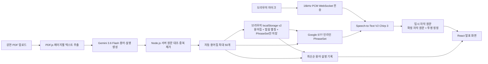

# Lecture Context AI · 강연맥락 AI

강연 PDF에서 전문용어를 자동으로 추출해 실시간 음성인식 정확도를 높이고, 자막에 어려운 용어가 등장할 때마다 쉬운 설명을 최신순 기록으로 보여주는 해커톤 MVP입니다.

Google API 자격증명이 없어도 내장된 샘플 강연으로 전체 발표 흐름을 시연할 수 있습니다.

## 해결하려는 문제

일반적인 실시간 자막은 강연자의 말을 글자로 바꾸지만, 청중이 모르는 전문용어의 의미까지 설명하지는 않습니다. Lecture Context AI는 강연 자료를 먼저 읽어 자동 용어집을 만들고, 이 용어집을 음성인식 힌트와 청중용 해설에 동시에 사용합니다.

## 주요 기능

- 텍스트 PDF의 페이지별 내용 추출
- Gemini를 이용한 전문용어·영문 표기·한글 발음 별칭·쉬운 설명 자동 생성
- PDF 원문에 실제 존재하는 용어만 서버에서 재검증
- 최대 50개 용어로 Google STT 인라인 `PhraseSet` 생성
- 한국어 실시간 임시·확정 자막 표시
- `레그 → RAG`처럼 한글 발음을 정식 용어로 바꾸되 원문과 `자동 정정` 표시를 남기는 투명한 확정 자막 정정
- 자막 속 전문용어 강조와 반복 언급을 보존하는 최신순 설명 피드
- 큰 글씨, 고대비, 전체 화면 등 발표 접근성 기능
- 분석된 전체 용어 객체와 PhraseSet을 브라우저에 자동 저장하고 다시 불러오기
- 이 브라우저의 저장 용어집 목록, 이름 변경, 삭제
- 실시간 강연 음성과 PDF를 서버에 저장하지 않는 휘발성 처리
- 같은 음원으로 STT를 반복 비교하기 위한 localhost 전용 개발 녹음 fixture
- API 없이 실행되는 발표용 데모와 자동 종료 리포트

## 시스템 작동 구조



### 실제 사용 순서

1. 사용자가 텍스트가 포함된 PDF를 업로드합니다.
2. 브라우저가 PDF를 페이지별 텍스트로 변환합니다.
3. Gemini가 강연에 중요한 전문용어 후보, 한글 발음 별칭과 쉬운 설명을 생성합니다.
4. 서버가 후보 용어를 PDF 원문과 다시 대조하고 발음 별칭의 문자·길이·개수·충돌 위험을 검증합니다.
5. 검증된 전체 용어 객체와 PhraseSet만 버전 2 브라우저 저장소에 자동 저장합니다. 기존 버전 1 저장소는 용어 ID를 유지한 채 별칭 없는 버전 2 데이터로 명시적으로 이전합니다. PDF, 추출 페이지 텍스트, PDF URL, 경고, 실시간 강연 음성은 저장하지 않습니다.
6. 같은 브라우저에서 저장 용어집을 불러오면 Gemini 분석 API를 다시 호출하지 않고 용어와 PhraseSet으로 준비 화면을 구성합니다.
7. 검증된 용어, 한글 발음 별칭과 PDF에 존재하는 영문 확장 표기를 Google STT `PhraseSet`에 전달합니다. 전체 힌트는 50개를 넘지 않습니다.
8. 브라우저 마이크 음성을 16kHz mono PCM으로 변환해 WebSocket으로 보냅니다.
9. Chirp 3가 반환한 임시 자막은 손대지 않고 그대로 표시합니다. 확정 자막의 검증된 발음 별칭만 정식 용어로 바꾸고 `자동 정정` 표지와 `원문 → 정식 용어` 설명을 함께 표시합니다.
10. 정식 표기나 발음 별칭으로 용어가 등장할 때마다 canonical 용어의 새 설명 카드를 오른쪽 피드 맨 위에 추가하고, 같은 용어의 이전 언급도 아래 기록에 유지합니다.
11. 강연 종료 이벤트를 받으면 확정 자막 수, 연결된 용어, 분석 단계에서 준비한 PhraseSet 힌트 수를 리포트로 보여줍니다.

### 브라우저 저장 용어집

- 새 PDF 분석과 샘플 분석이 끝나면 용어집이 자동 저장됩니다.
- 첫 화면의 `이 브라우저의 용어집`에서 앱 새로고침이나 서버 재시작 뒤에도 목록을 보고 바로 불러올 수 있습니다.
- 저장 항목은 `id`, `name`, `createdAt`, `updatedAt`, `spokenAliases`를 포함한 완전한 `GlossaryTerm[]`, `phraseSet`뿐입니다.
- 버전·필드·길이·개수·PhraseSet 대응 관계를 엄격히 검증하고, 유니코드·공백·대소문자 기준 중복을 제거합니다. 버전 1은 버전 2로 이전하며 용어 ID는 다시 만들지 않습니다.
- 전문용어가 하나도 없는 분석 결과는 저장하거나 저장 용어집 흐름으로 시작하지 않습니다.
- 용어집은 현재 브라우저와 사이트 저장소에만 존재합니다. 다른 브라우저·기기와 동기화되지 않으며 브라우저 데이터를 지우면 함께 삭제됩니다.
- 같은 사이트를 연 다른 탭의 저장 변경은 `storage` 이벤트로 목록에 반영합니다. 완전히 동시에 저장·이름 변경·삭제하면 `localStorage`의 한계상 마지막 쓰기가 우선하며 원자적 잠금은 제공하지 않습니다.
- 저장 용어집은 이름을 바꾸거나 삭제할 수 있습니다. 저장 공간 부족·차단·손상·버전 불일치 오류는 화면에 표시됩니다. 손상·버전 불일치는 사용자가 확인한 뒤 명시적으로 초기화할 수 있으며 자동 삭제하지 않습니다.
- 자동 저장에 실패해도 현재 분석 결과와 강연 시작 기능은 유지되며, 저장소를 정리한 뒤 같은 준비 화면에서 저장을 다시 시도할 수 있습니다.
- 저장 용어집을 불러와도 실시간 STT, 자막 강조, 반복 언급을 보존하는 용어 설명 피드와 결과 리포트가 동일하게 동작합니다.

## 기술 스택

| 영역 | 기술 | 사용 이유 |
|---|---|---|
| 프론트엔드 | React 19, TypeScript | 화면 상태와 실시간 자막 UI를 컴포넌트 단위로 관리 |
| 빌드 도구 | Vite 7 | 빠른 개발 서버와 작은 설정으로 해커톤 개발 속도 확보 |
| 스타일 | Tailwind CSS 4 | 반응형 발표 화면과 접근성 상태를 빠르게 구성 |
| 아이콘 | Lucide React | 일관된 경량 SVG 아이콘 제공 |
| PDF | PDF.js | 별도 Python/OCR 서버 없이 브라우저에서 텍스트 추출 |
| 백엔드 | Node.js 22, Express 5 | 프론트와 같은 TypeScript 생태계에서 API와 정적 파일 제공 |
| 실시간 통신 | WebSocket (`ws`) | 브라우저 오디오와 자막 이벤트를 양방향 스트리밍 |
| 요청 검증 | Zod | PDF 분석 요청과 WebSocket 용어 데이터 검증 |
| 생성형 AI | Gemini Developer API, `gemini-3.6-flash` | PDF 기반 전문용어와 비전공자용 설명 생성 |
| 음성인식 | Google Cloud Speech-to-Text V2, `chirp_3` | 한국어 스트리밍 자막과 PhraseSet 기반 음성 적응 |
| 테스트 | Vitest, TypeScript | 용어 검증 로직과 타입 안정성 확인 |
| 배포 | Docker, Google Cloud Run | 프론트와 백엔드를 단일 컨테이너로 배포 |

## 외부 API

### Gemini Developer API

- 호출 시점: PDF 업로드 후 한 번
- 입력: 페이지 번호가 포함된 PDF 추출 텍스트
- 출력: `term`, `english`, `spokenAliases`, `easyExplanation` 구조의 JSON
- 안전장치: 서버가 PDF 원문에 실제 존재하는 표기만 최종 채택
- 장애 대응: API 키가 없거나 호출에 실패하면 보수적 휴리스틱 추출로 자동 전환

### Google Cloud Speech-to-Text V2

- 호출 시점: 사용자가 실시간 강연을 시작했을 때
- 모델: `chirp_3`, 언어: `ko-KR`
- 오디오: LINEAR16, 16kHz, mono
- 적응: canonical 용어·검증된 한글 발음 별칭·영문 확장 표기를 인라인 `PhraseSet`으로 전달
- 스트림 규칙: 첫 메시지에 암시적 recognizer와 전체 설정만 보내고, 이후 메시지는 15KB 이하 `audio`만 전송
- 결과: 임시 자막과 확정 자막을 WebSocket으로 브라우저에 전달

2026-08-08에 로컬 ADC와 `us-speech.googleapis.com`을 사용해 빈 PhraseSet, 인라인 PhraseSet 1개, 한국어 음성 스트림을 실제 V2 API로 검증했습니다. 한국어 음성 검증에서는 임시 자막과 확정 자막이 모두 반환되었습니다.

API 키와 Google 인증정보는 브라우저에 전달하지 않고 서버 환경변수와 Cloud Run 서비스 계정에서만 사용합니다.

## 내부 API와 WebSocket

| 방식 | 경로 | 역할 |
|---|---|---|
| `GET` | `/api/health` | Gemini·Google STT 설정 여부 확인 |
| `GET` | `/api/demo` | 자격증명 없이 사용할 샘플 PDF·용어집 반환 |
| `POST` | `/api/analyze` | PDF 페이지 텍스트를 받아 자동 용어집 생성 |
| `GET` | `/api/dev/audio-fixtures` | 개발용 고정 실험 문장과 로컬 녹음 목록 반환 |
| `POST` | `/api/dev/audio-fixtures` | 검증된 16kHz mono PCM WAV를 로컬 fixture로 저장 |
| WebSocket | `/ws` | 마이크 오디오 업로드와 자막 이벤트 스트리밍 |

WebSocket은 `start` 메시지로 `live` 또는 `demo` 모드를 시작합니다. 이 메시지에는 자동 용어집과 검증된 전체 `phraseSet`이 함께 포함되며, 실시간 모드에서는 이후 오디오 바이너리를 전송합니다. 서버는 `ready`, `interim`, `final`, `error`, `ended` 이벤트를 반환합니다. `interim.text`는 STT 원문이며 자동 정정하지 않습니다. `final`은 표시용 `text`, 원본 `rawText`, 위치가 포함된 `corrections`, 실제 출현 순서와 반복을 보존한 `detectedTerms`를 함께 반환합니다. 화면은 이를 최신순 설명 피드에 쌓고 `ended`를 받으면 자막과 정정 근거를 보존한 채 결과 리포트로 이동합니다.

`pnpm dev`는 Vite와 백엔드를 모두 `127.0.0.1`에 bind해 LAN 연결 자체를 받지 않습니다. `/api/dev/audio-fixtures`는 여기에 더해 `NODE_ENV=development`와 요청의 socket·Host·Origin을 검사합니다. 프로덕션의 개발 API 요청은 SPA HTML로 fallback하지 않고 JSON 404를 반환합니다.

## 폴더 구조

```text
client/
  src/App.tsx                 전체 화면과 사용자 흐름
  src/components/AudioFixtureRecorder.tsx  개발용 고정음원 녹음 UI
  src/components/TransparentCaption.tsx  원문 확인이 가능한 자동 정정 자막 UI
  src/hooks/useLectureStream.ts  WebSocket·자막 상태 관리
  src/lib/glossary-storage.ts 브라우저 용어집 v2 검증·v1 이전·저장·로드
  src/lib/pdf.ts              PDF.js 텍스트 추출
  src/lib/pcm-recorder.ts     마이크 PCM 변환
server/
  src/app.ts                  주입 가능한 HTTP 앱·개발용 API 경계
  src/index.ts                HTTP listen·WebSocket 서버
  src/services/audio-fixtures.ts  WAV 검증·원자적 저장·오프라인 PCM 로드
  src/services/glossary.ts    Gemini·원문 검증·PhraseSet 생성
  src/services/spoken-aliases.ts  발음 별칭 제한·충돌 제거·알려진 별칭 보완
  src/services/caption.ts     확정 자막 용어 연결·원문 보존·안전한 위치 기반 정정
  src/services/speech.ts      Google STT V2 스트리밍
  src/services/demo.ts        발표용 샘플 데이터
docs/HANDOFF.md               인수인계 상태와 다음 작업
test-fixtures/stt/            고정 실험 문장과 Git 제외 로컬 WAV
Dockerfile                    Cloud Run용 다단계 이미지
```

## 로컬 실행

필요 환경은 Node.js 22 이상과 pnpm 11입니다.

```bash
pnpm install
cp .env.example .env
pnpm dev
```

- 웹 화면: `http://localhost:5173`
- 백엔드 API: `http://localhost:8787`

환경변수 없이도 첫 화면에서 `샘플 강연 바로 체험하기`를 선택해 데모를 실행할 수 있습니다.

### 개발용 고정음원 녹음

`pnpm dev`로 `http://localhost:5173`을 열면 첫 화면 아래에 `개발용 고정음원 녹음` 카드가 나타납니다. 고정 문장을 한 번 읽어 저장하면 다음 파일이 만들어집니다.

- 오디오: `test-fixtures/stt/audio/*.wav`
- 로컬 메타데이터: `test-fixtures/stt/manifest.local.json`
- 형식: canonical RIFF/WAVE, PCM1, mono, 16kHz, 16-bit, 최대 120초·3,840,000 PCM 바이트

두 파일은 Git과 Docker build context에서 제외되며 자동 만료되지 않습니다. 화자 label은 실제 이름이 아닌 `speaker-a`, `speaker-b` 가명만 사용하고, 필요 없어진 파일은 직접 삭제합니다. 녹음 시작 시 화자·환경·실험문장을 snapshot하므로 준비된 WAV의 메타데이터가 이후 화면 선택과 섞이지 않습니다. 브라우저 timer가 지연돼도 capture 계층이 PCM을 3,840,000바이트에서 hard cap합니다.

저장 시 `.writer.lock`을 짧게 획득해 같은 fixture root를 연 복수 개발 서버의 manifest 갱신을 직렬화합니다. 비정상 종료로 60초 이상 남은 lock은 다음 저장이 회수합니다. 저장 모듈은 PCM을 15,000바이트 이하의 짝수 길이 청크로 바이트 손실 없이 다시 읽을 수 있지만 실제 Google STT 호출과 정확도 평가는 이번 기능에 포함하지 않습니다.

개발 서버를 실행한 상태에서 아래 명령을 사용하면 가장 최근 녹음을 실시간 속도로 두 번 재생합니다. 첫 번째 실행은 PhraseSet이 없고, 두 번째 실행은 `scripts.json`의 `targetTerms`를 인라인 PhraseSet으로 사용합니다. 특정 녹음을 비교하려면 명령 뒤에 manifest의 녹음 ID를 붙입니다.

```bash
pnpm stt:compare
pnpm stt:compare -- <recording-id>
```

실행 결과는 `test-fixtures/stt/results/*.json`에 저장되며 Git·Docker에서 제외됩니다. 새 결과 형식은 표시용 정정 자막과 STT 원문 `rawText`, 정정 내역을 함께 보존합니다. 각 조건의 영문 기준 표기 집계는 자동 정정된 문장이 아니라 원문 STT를 기준으로 하며, 실행 시간과 오류도 기록합니다. 두 조건 모두 실제 Google STT 사용량이 발생합니다. `targetTerms`는 비교 후보이므로 발화자가 화면의 기준 문장을 그대로 읽었다고 확인된 경우에만 미일치 항목을 인식 실패로 계산합니다.

이 경계는 동일 사용자가 제어하는 로컬 개발 환경을 대상으로 합니다. 서버가 직접 사용하는 fixture root·audio·파일의 symlink와 생성 경로 이탈은 거부하지만, 악의적인 동일 사용자 프로세스와 모든 ancestor symlink/TOCTOU를 격리하는 보안 sandbox는 아닙니다.

## 환경변수

```bash
PORT=8080
GOOGLE_CLOUD_PROJECT=your-google-cloud-project
GOOGLE_STT_LOCATION=us
GOOGLE_STT_MODEL=chirp_3
GEMINI_API_KEY=
GEMINI_MODEL=gemini-3.6-flash
```

### Gemini 연결

Google AI Studio에서 API 키를 발급해 `.env`의 `GEMINI_API_KEY`에 설정합니다.

### Google STT 연결

Google Cloud 프로젝트에서 Speech-to-Text V2 API를 활성화하고 로컬 Application Default Credentials를 준비합니다.

```bash
gcloud auth application-default login
```

Cloud Run에서는 로컬 인증 파일 대신 서비스 계정에 Speech-to-Text 호출 권한을 부여합니다.

## 검증 명령

```bash
pnpm typecheck
pnpm test
pnpm build
pnpm start
docker build -t lecture-context-ai:mvp .
```

## Cloud Run 배포

프론트엔드와 백엔드는 하나의 컨테이너로 실행됩니다. Gemini 키는 소스에 기록하지 않고 Secret Manager 또는 Cloud Run secret 환경변수로 연결합니다.

```bash
gcloud run deploy lecture-context-ai \
  --source . \
  --region asia-northeast3 \
  --allow-unauthenticated \
  --min 0 \
  --max 1 \
  --memory 512Mi \
  --cpu 1 \
  --timeout 3600 \
  --set-env-vars GOOGLE_CLOUD_PROJECT=YOUR_PROJECT_ID,GOOGLE_STT_LOCATION=us,GOOGLE_STT_MODEL=chirp_3 \
  --set-secrets GEMINI_API_KEY=gemini-api-key:latest
```

## 개인정보와 비용 원칙

- 실시간 강연 음성과 PDF 파일은 서버나 브라우저 저장소에 영구 저장하지 않습니다.
- 예외적으로 개발자가 녹음 카드에서 명시적으로 만든 처리 음성만 프로젝트 로컬 fixture에 저장하며, Git·Docker에는 포함하지 않습니다.
- 브라우저 저장소에는 검증된 용어집·발음 별칭과 PhraseSet만 저장합니다. API 키, PDF URL, 추출 페이지 텍스트, 분석 경고도 저장하지 않습니다.
- Gemini는 새 PDF 업로드 시 한 번만 호출합니다. 저장 용어집을 다시 사용할 때는 호출하지 않아 실시간 지연과 토큰 비용을 줄입니다.
- STT는 전송한 오디오 길이를 기준으로 과금될 수 있습니다.
- 공개 배포 전 Google Cloud 예산 알림과 API 할당량을 설정해야 합니다.

## 현재 MVP 제한

- 텍스트가 포함된 10MB·100페이지 이하 PDF만 지원합니다.
- 스캔 PDF OCR, 화자 분리, 번역, TTS는 포함하지 않습니다.
- 데이터베이스, 회원가입, 강연자 검수 화면은 포함하지 않습니다.
- 브라우저 용어집은 현재 브라우저에만 있으며 계정 동기화·내보내기·가져오기를 지원하지 않습니다.
- 실시간 용어 설명 기록은 현재 강연 세션에만 유지되며 새 강연을 시작하면 초기화됩니다.
- 자동 발음 별칭은 한글 형태와 보수적인 안전 규칙을 통과한 후보만 사용하지만, 모든 화자·문맥에서 오정정을 완전히 막는 의미 판별기는 아닙니다. 정정 표지에서 원문을 항상 확인할 수 있습니다.
- 실제 Gemini PDF 분석 경로는 API 키 연결 후 추가 검증이 필요합니다.
- Google STT API 연결과 한국어 음성 응답은 검증했지만, 실제 발표에 사용할 브라우저·마이크 조합의 권한과 음질은 별도 현장 확인이 필요합니다.
- 긴 강연을 위한 STT 스트림 자동 재연결은 아직 구현하지 않았습니다.
- 실제 발화 시작 시점을 신뢰성 있게 추적하지 않으므로 결과 화면에서 실시간 표시 지연을 추정해 보여주지 않습니다.
- 개발용 고정음원은 `pnpm stt:compare`로 PhraseSet 적용 전후 실제 Google STT A/B 재생까지 지원합니다. 정답 대본 기반 정확도 평가는 후속 실험입니다.
- 쉬운 용어 정의는 제공하지만 `이 용어가 지금 등장한 이유`를 설명하는 맥락 문장은 다음 버전 작업입니다.

현재 상태와 후속 작업은 [인수인계 문서](docs/HANDOFF.md)를 참고하세요. 실제 고정음원 A/B 관찰과 발음 별칭 기반 A/B/C 후속 계획은 [STT PhraseSet 파일럿 실험 기록](docs/STT_PHRASESET_PILOT.md), 논문 연구문제·평가 설계·발표 흐름은 [논문·발표 구성안](docs/PAPER_PRESENTATION_PLAN.md)에 정리되어 있습니다.
