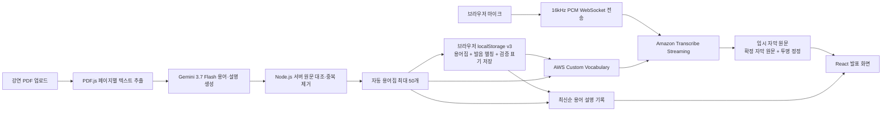

# 강연 용어 AI

강연 PDF에서 전문용어를 자동으로 추출해 실시간 음성인식 정확도를 높이고, 자막에 어려운 용어가 등장할 때마다 쉬운 설명을 최신순으로 보여주는 해커톤 MVP입니다.

AWS 자격증명이 없어도 내장된 샘플 강연으로 자막·용어 설명 흐름을 시연할 수 있습니다.

## 해결하려는 문제

일반적인 실시간 자막은 강연자의 말을 글자로 바꾸지만, 청중이 모르는 전문용어의 의미까지 설명하지는 않습니다. 강연 용어 AI는 강연 자료를 먼저 읽어 자동 용어집을 만들고, 이 용어집을 음성인식 힌트와 청중용 해설에 동시에 사용합니다.

## 주요 기능

- 텍스트 PDF의 페이지별 내용 추출
- Gemini를 이용한 전문용어·영문 표기·한글 발음 별칭·쉬운 설명 자동 생성과 안전 규칙 기반 자동 승인
- PDF 원문에 실제 존재하는 용어만 서버에서 재검증
- 최대 50개 용어와 발음 별칭으로 AWS Custom Vocabulary 준비·재사용
- Amazon Transcribe Streaming의 한국어 partial·final 자막을 같은 발화 구간에서 교체 표시
- 별도 발표 PDF를 브라우저 PDF.js canvas에서 여는 발표 화면 기반
- `RAG(레그)`처럼 정식 용어 바로 옆에 STT 원문을 괄호로 남기는 투명한 확정 자막 정정
- 자막 속 전문용어 강조와 발표 화면 오른쪽의 최신 용어 카드 최대 3개
- 큰 글씨, 고대비, 전체 화면 등 발표 접근성 기능
- 분석된 전체 용어 객체와 PhraseSet을 브라우저에 자동 저장하고 다시 불러오기
- 이 브라우저의 저장 용어집 목록, 이름 변경, 삭제와 손상 원본의 무손실 격리·복구 JSON 내보내기
- 준비 화면에서 잘못 추출된 용어를 이번 강연에만 제외하거나, 확인 후 저장본에도 영구 반영
- 실시간 강연 음성과 PDF를 서버에 저장하지 않는 휘발성 처리
- 저장 녹음을 선택하고 유료 Google STT 스트림 정확히 3회 호출에 동의한 뒤 A/B/C 진행률과 저장 결과 기록을 확인하는 localhost 전용 개발 도구
- 저장된 브라우저 PDF 용어집과 정확한 대본을 5개 안팎의 실험 케이스로 스냅샷하고, 세트·케이스별 결과를 필터·집계·CSV/TSV/JSON으로 내보내는 STT 연구 흐름
- API 없이 실행되는 발표용 데모와 자동 종료 리포트
- 확정 자막 10,000줄에서도 전체 배열을 매번 복사하지 않는 chunk 기반 세션 저장소와 최대 100행씩 여는 결과 목록
- 표시 자막·STT 원문·자동 정정 근거·종료 상태·참조 용어 스냅샷을 보존하는 자체 완결형 결과 JSON v2/TXT 내보내기와 저장 확인 전 이탈 경고

## 시스템 작동 구조



### 실제 사용 순서

1. 사용자가 텍스트가 포함된 PDF를 업로드합니다.
2. 브라우저가 PDF를 페이지별 텍스트로 변환합니다.
3. Gemini가 강연에 중요한 전문용어 후보, 한글 발음 별칭 후보와 쉬운 설명을 생성합니다.
4. 서버가 후보 용어를 PDF 원문과 먼저 대조한 뒤, 영문 표기가 있는 용어의 Gemini 한글 발음을 자동 승인합니다. 완성형 한글·길이·개수·일반 단어 차단·용어 간 충돌 규칙을 통과한 발음만 남기며, 알려진 기술용어 목록은 누락 발음을 보완하는 데만 사용합니다.
5. 검증된 전체 용어 객체와 STT 준비 표기(`phraseSet`)만 버전 3 브라우저 저장소에 자동 저장합니다. 기존 버전 1 저장소는 용어 ID와 기존 PhraseSet을 유지한 채 빈 `spokenAliases`를 넣어 버전 3으로 이전하며, WebSocket 서버도 별칭을 몰래 보완하지 않습니다. 버전 2는 같은 안전 규칙을 통과한 별칭만 보존하고 제거된 별칭의 PhraseSet 항목도 함께 제거해 버전 3으로 이전합니다. PDF, 추출 페이지 텍스트, PDF URL, 경고, 실시간 강연 음성은 저장하지 않습니다.
   업로드 화면은 별도 추정치 대신 이 실제 경계에 맞춰 `PDF 텍스트 추출` → `전문용어 자동 선별` → `브라우저 용어집 검증·저장` 완료 상태를 순서대로 표시합니다. 각 완료 상태를 화면에 제시한 뒤에만 준비 화면으로 전환하며, 저장 실패는 3단계 실패로 표시하되 유효한 현재 분석과 강연 시작 기능은 유지합니다.
6. 같은 브라우저에서 저장 용어집을 불러오면 Gemini 분석 API를 다시 호출하지 않고 용어와 검증 표기로 준비 화면을 구성합니다. 한 항목만 손상된 경우 전체 원본 JSON을 별도 복구 키에 먼저 보존한 뒤 유효한 항목만 자동 격리 복구합니다. JSON 자체가 깨졌거나 미래 버전인 경우에는 사용자의 복구 동작 전까지 원본을 덮어쓰지 않습니다.
7. 준비 화면에서 잘못 추출된 용어를 제외합니다. 제외 선택은 기본적으로 현재 세션에만 적용되며, 별도 확인을 거친 `저장본에 반영` 동작만 같은 브라우저 용어집을 영구 변경합니다.
8. 분석 PDF와 독립된 발표 PDF를 선택합니다. 방금 분석한 PDF를 명시적으로 재사용할 수도 있으며, 발표 PDF는 서버로 보내지 않고 브라우저 메모리에서 한 번 연 PDF.js 문서를 준비 미리보기와 실제 발표 화면이 공유합니다.
9. 검증된 원본 전문용어는 최대 50개까지 사용합니다. canonical·영문·안전한 한글 발음 표기로 AWS Custom Vocabulary table을 만들고, 같은 내용은 hash 기반 리소스를 재사용합니다.
10. 서버가 `captureRequested`를 보낸 뒤에만 브라우저가 마이크 권한을 요청하고 recorder를 준비합니다. 브라우저가 `captureReady`를 보내기 전에는 유료 AWS stream을 만들지 않습니다. recorder가 먼저 만든 PCM은 최대 0.5초만 보존하고, 서버의 `readyForAudio`가 오면 순서대로 전송합니다. 권한·첫 PCM·AWS 준비가 각각 제한 시간을 넘기거나 버퍼가 넘치면 오래된 음성을 버리지 않고 세션을 명시적으로 실패시킵니다.
11. Amazon Transcribe가 반환한 partial은 `ResultId`별 revision으로 즉시 같은 위치를 교체하고, final이 오면 해당 partial을 제거해 확정 자막을 한 번만 추가합니다. 앱은 debounce하지 않으며 `Stable` 앞부분과 변경 가능한 꼬리의 경계를 함께 보존합니다. 확정 자막의 검증된 발음 별칭만 정식 용어로 바꾸고 `RAG(레그)`처럼 원래 인식 표기를 바로 옆에 함께 표시합니다.
12. 발표 PDF 위 하단에는 자막을, 오른쪽에는 최신 고유 용어 카드 최대 3개를 띄웁니다. 페이지 이동과 자막·용어·전체 화면은 버튼과 키보드로 제어합니다.
13. 종료 시 브라우저와 서버에 남은 PCM을 AWS 입력 종료 전에 모두 전달하고 늦은 final을 기다립니다. 실제 서버 `ended`를 받은 세션만 완료 결과로 전환하고, 연결 준비 중 취소는 결과를 만들지 않습니다. 결과 화면은 확정 자막 수, 연결된 용어, 검증 표기 수와 종료 상태를 보여주며 전체 결과를 자체 완결형 JSON v2/TXT로 저장할 수 있습니다. File System Access API의 쓰기 완료 또는 사용자의 명시적인 파일 생성 확인 전에는 새로고침·화면 이탈 경고를 유지합니다.

### 브라우저 저장 용어집

- 새 PDF 분석과 샘플 분석이 끝나면 용어집이 자동 저장됩니다.
- `#/lecture`의 `이 브라우저의 용어집`에서 앱 새로고침이나 서버 재시작 뒤에도 목록을 보고 바로 불러올 수 있습니다.
- 저장 항목은 `id`, `name`, `createdAt`, `updatedAt`, `spokenAliases`를 포함한 완전한 `GlossaryTerm[]`, `phraseSet`뿐입니다.
- 버전·필드·길이·개수·안전한 한글 발음·PhraseSet 대응 관계를 엄격히 검증하고, 유니코드·공백·대소문자 기준 중복을 제거합니다. 버전 1은 빈 별칭 상태로 버전 3으로 이전하며 용어 ID와 기존 PhraseSet을 다시 만들지 않습니다. 버전 2의 기존 용어집도 안전한 버전 3 데이터로 이전됩니다. v1 용어집에 별칭 정정과 별칭 STT 힌트를 추가하려면 PDF를 새로 분석해 저장해야 합니다.
- 이전 구현에서 PhraseSet 표기 50개로 잘린 버전 3 용어집은 저장된 원본 용어와 안전한 한글 발음을 이용해 로드할 때 자동 보완하며 Gemini를 다시 호출하지 않습니다.
- 전문용어가 하나도 없는 분석 결과는 저장하거나 저장 용어집 흐름으로 시작하지 않습니다.
- 용어집은 현재 브라우저와 사이트 저장소에만 존재합니다. 다른 브라우저·기기와 동기화되지 않으며 브라우저 데이터를 지우면 함께 삭제됩니다.
- 같은 사이트를 연 다른 탭의 저장 변경은 `storage` 이벤트로 현재 분석과 목록에 반영합니다. 지원 브라우저에서는 Web Locks로 저장·이름 변경·삭제·복구의 read-modify-write를 탭 사이에서 직렬화합니다. Web Locks가 없는 브라우저의 fallback은 같은 탭만 직렬화하므로, 그 환경의 완전 동시 변경에는 마지막 쓰기 우선 위험이 남습니다.
- 저장 용어집은 이름을 바꾸거나 삭제할 수 있습니다. 저장 공간 부족·차단·손상·버전 불일치 오류는 화면에 표시됩니다.
- 개별 항목 손상·v1/v2 이전·정규화 때문에 원본이 바뀌면 앱은 전체 원문을 `lecture-context-ai.glossaries.recovery`에 먼저 보존하고 유효한 항목만 활성 저장소로 옮깁니다. 안전한 백업을 쓸 수 없으면 원본을 덮어쓰는 저장·이름 변경·삭제도 진행하지 않습니다.
- JSON envelope 손상, 지원하지 않는 버전, 현재 한도 초과는 자동 초기화하지 않습니다. 사용자가 `원본 보존 후 복구`를 선택하면 원문을 먼저 백업하고, 알려진 스키마의 유효한 항목만 최대 50개까지 복구합니다. 활성 원문과 백업은 화면에서 복구 JSON으로 내보낼 수 있습니다. recovery key 자체가 깨져도 그 원문을 그대로 비상 내보낸 뒤, 사용자가 명시적으로 손상 복구 데이터만 지울 수 있습니다.
- 자동 저장에 실패해도 현재 분석 결과와 강연 시작 기능은 유지되며, 저장소를 정리한 뒤 같은 준비 화면에서 저장을 다시 시도할 수 있습니다.
- 준비 화면의 제외 선택을 저장본에 반영하면 같은 용어집을 갱신하며 별도 버전 이력을 만들지 않습니다. 제거한 용어를 되돌리려면 PDF를 다시 분석해야 하므로 확인 대화상자를 거칩니다.
- 저장 용어집을 불러와도 실시간 STT, 자막 강조, 최신 고유 용어 카드와 결과 리포트가 동일하게 동작합니다.

## 기술 스택

| 영역 | 기술 | 사용 이유 |
|---|---|---|
| 프론트엔드 | React 19, TypeScript | 화면 상태와 실시간 자막 UI를 컴포넌트 단위로 관리 |
| 빌드 도구 | Vite 7 | 빠른 개발 서버와 작은 설정으로 해커톤 개발 속도 확보 |
| 스타일 | Tailwind CSS 4 | 반응형 발표 화면과 접근성 상태를 빠르게 구성 |
| 아이콘 | Lucide React | 일관된 경량 SVG 아이콘 제공 |
| PDF | PDF.js | 별도 Python/OCR 서버 없이 브라우저에서 텍스트 추출 |
| 백엔드 | Node.js 22, Express 5 | 프론트와 같은 TypeScript 생태계에서 API와 정적 파일 제공 |
| 실시간 통신 | WebSocket (`ws`) | 브라우저 오디오와 자막 이벤트를 양방향 스트리밍 |
| 요청 검증 | Zod | PDF 분석 요청과 WebSocket 용어 데이터 검증 |
| 생성형 AI | Gemini Developer API, `gemini-3.7-flash` (`low` thinking) | PDF 기반 전문용어와 비전공자용 설명 생성 |
| 음성인식 | Amazon Transcribe Streaming | 한국어 partial/final 자막과 Custom Vocabulary 기반 음성 적응 |
| 테스트 | Vitest, TypeScript | 용어 검증 로직과 타입 안정성 확인 |
| 배포 | Docker, Google Cloud Run | 프론트와 백엔드를 단일 컨테이너로 배포 |

## 외부 API

### Gemini Developer API

- 호출 시점: PDF 업로드 후 한 번
- 모델: `gemini-3.7-flash`, 사고 수준 `low` (`GEMINI_THINKING_LEVEL`로 `medium` 또는 `high` 선택 가능)
- 입력: 페이지 번호가 포함된 PDF 추출 텍스트
- 출력: `term`, `english`, `spokenAliases`, `easyExplanation` 구조의 JSON
- 긴 문서 처리: 단일 요청을 120,000자 이하로 제한하되 모든 페이지가 최소한 포함되도록 페이지별 예산을 배분하고, 긴 페이지는 앞·뒤 문맥을 보존
- 안전장치: 서버가 PDF 원문에 실제 존재하는 표기만 최종 채택하고, 문서가 잘렸거나 Gemini 결과가 적으면 전체 페이지의 보수적인 한국어 기술 복합어 휴리스틱 결과를 병합
- 장애 대응: API 키 누락·timeout·upstream 실패 시 PDF 원문에 정확히 존재하는 한국어 기술 복합어만 보수적으로 추출하며, 비한국어 대문자나 임의 표기는 용어로 추정하지 않음. 호출자 연결 종료는 Gemini 요청까지 전파하고 취소를 fallback 성공으로 위장하지 않음

### Amazon Transcribe Streaming

- 호출 시점: 사용자가 실시간 강연을 시작했을 때
- 언어·오디오: `ko-KR`, PCM16, 16kHz, mono
- partial 안정화: `AWS_TRANSCRIBE_PARTIAL_STABILITY=off|low|medium|high` (개발 기본 `low`)
- 적응: canonical·영문·안전한 한글 발음으로 만든 content-addressed Custom Vocabulary
- handshake: `captureRequested` → 브라우저 recorder 준비 → `captureReady` 이후에만 provider 생성 → 서버 큐 준비(`readyForAudio`)와 AWS 승인(`providerAccepted`) 확인
- 종료: 클라이언트와 서버의 대기 PCM을 먼저 비우고 AWS 입력을 닫은 뒤 늦은 final을 최대 5초 기다려 `ended`
- 보호: 준비 전 브라우저 PCM과 서버 오디오 큐를 각각 최대 0.5초로 제한하고, 서버→브라우저 이벤트도 128KB high-water·256KB 대기 큐·1MB hard limit으로 제한합니다. WebSocket origin·동시 stream·세션 길이·권한·첫 PCM timeout을 검사하고, 초과 시 final·terminal 순서를 훼손하지 않고 세션을 실패시킵니다.

빠른 모델과 정확한 모델을 동시에 두 번 호출하는 구조가 아닙니다. 하나의 AWS streaming 세션이 보내는 변경 가능한 partial을 먼저 보여주고, 같은 `ResultId`의 final이 오면 그 자리를 확정 결과로 교체합니다. 따라서 partial의 문구는 바뀔 수 있고, `Stable`로 표시된 앞부분만 안정 영역으로 취급합니다.

AWS 자격증명은 브라우저로 전달하지 않으며 서버의 AWS SDK 기본 credential provider chain만 사용합니다. production 실시간 경로는 `STT_PROVIDER` 값과 무관하게 AWS만 선택합니다. Google provider와 Google A/B/C 고정음원 연구 도구는 `NODE_ENV=development`에서만 과거 실험 재현용으로 남아 있습니다. 실제 AWS 지연·정확도는 아직 측정 전이므로 성능 보장값을 두지 않습니다.

## 내부 API와 WebSocket

| 방식 | 경로 | 역할 |
|---|---|---|
| `GET` | `/api/health` | Gemini·STT·Custom Vocabulary의 설정 감지와 외부 검증 상태를 구분해 반환(실제 검증은 `pnpm aws:doctor`) |
| `GET` | `/api/demo` | 자격증명 없이 사용할 샘플 PDF·용어집 반환 |
| `POST` | `/api/analyze` | PDF 페이지 텍스트를 받아 자동 용어집 생성 |
| `POST` | `/api/vocabulary/prepare` | 검증된 용어로 AWS Custom Vocabulary 준비·재사용 |
| `GET` | `/api/dev/audio-fixtures` | 개발용 고정 실험 문장과 로컬 녹음 목록 반환 |
| `POST` | `/api/dev/audio-fixtures` | 검증된 16kHz mono PCM WAV를 로컬 fixture로 저장 |
| `GET/POST` | `/api/dev/experiment-studies` | 로컬 실험 세트 목록 조회·생성 |
| `POST` | `/api/dev/experiment-studies/:studyId/cases` | 저장된 브라우저 용어집과 정확한 대본으로 immutable 케이스 스냅샷 추가 |
| `GET` | `/api/dev/stt-comparison-aggregates` | study/case별 완전한 accuracy 결과 A/B/C 평균 조회 |
| `POST` | `/api/dev/stt-comparison-jobs` | `recordingId`와 유료 STT 스트림 3회 명시적 동의를 받아 A/B/C 작업 시작 |
| `GET` | `/api/dev/stt-comparison-jobs/current` | 이 서버의 현재 작업 또는 CLI·다른 개발 서버가 보유한 공유 lock 상태 조회 |
| `GET` | `/api/dev/stt-comparison-jobs/:jobId` | 이 서버 프로세스 메모리에 있는 작업의 A/B/C 진행 상태 조회 |
| `GET` | `/api/dev/stt-comparisons?offset=<n>&limit=<n>` | 수정 시각 최신순 결과 기록과 페이지 정보 조회(기본 25개, 최대 100개) |
| `GET` | `/api/dev/stt-comparisons/:fileName` | 검증된 결과 파일 하나의 상세 리포트 조회 |
| WebSocket | `/ws` | 마이크 오디오 업로드와 자막 이벤트 스트리밍 |

WebSocket은 `start` 메시지로 `live` 또는 `demo` 모드를 시작합니다. 실시간 시작 메시지에는 검증된 용어와 준비 완료된 `vocabularyName`이 포함됩니다. live는 `captureRequested` → `captureReady` → `readyForAudio` → `providerAccepted` 순서를 클라이언트 상태 기계가 엄격히 검사하며, 과거의 일반 `ready` 신호나 순서가 뒤바뀐 이벤트는 protocol error입니다. API 없는 demo만 `ready` 뒤 미리 정한 자막을 보냅니다. 두 모드 모두 `partial`, `final`, `error`, `ended` 계약을 사용합니다. `partial`은 `segmentId`별 더 큰 revision만 현재 자막을 교체하고, `final`은 같은 segment의 partial을 제거합니다. `final`은 표시용 `text`, 원본 `rawText`, 위치가 포함된 `corrections`, 실제 출현 순서와 반복을 보존한 `detectedTerms`를 함께 반환합니다. 화면은 이를 최신순 설명 목록에 쌓고 실제 `ended`를 받은 경우에만 자막과 정정 근거를 보존한 결과 리포트로 이동합니다. 연결 준비 중 취소는 완료 결과를 만들지 않으며, 정상 종료의 `completed`와 늦은 final 대기 제한을 넘긴 `flush-timeout`도 구분합니다.

`pnpm dev`는 Vite와 백엔드를 모두 `127.0.0.1`에 bind해 LAN 연결 자체를 받지 않습니다. `/api/dev/*`는 여기에 더해 `NODE_ENV=development`와 요청의 socket·Host·Origin을 검사하는 개발 전용 경계입니다. 프로덕션의 개발 API 요청은 SPA HTML로 fallback하지 않고 JSON 404를 반환합니다.

## 폴더 구조

```text
client/
  src/App.tsx                 분석·저장·강연 세션 orchestration root
  src/components/PresentationPdfCanvas.tsx  발표 PDF double-buffer canvas 렌더러
  src/components/ExperimentWorkspace.tsx  DEV 전용 STT 실험실 탐색·라우트 셸
  src/components/ExperimentSetup.tsx  PDF 용어집·대본 실험 세트와 케이스 설정 UI
  src/components/AudioFixtureRecorder.tsx  개발용 고정음원 녹음 UI
  src/components/SttComparisonResults.tsx  저장된 A/B/C 결과 차트·자막·표·TSV UI
  src/components/TranscriptResultsList.tsx  긴 강연 결과의 100행 단위 접근 가능한 목록
  src/components/TransparentCaption.tsx  원문 확인이 가능한 자동 정정 자막 UI
  src/hooks/useLectureStream.ts  WebSocket·자막 상태 관리
  src/hooks/live-client-handshake.ts  live 캡처·provider handshake 상태 기계
  src/hooks/lecture-stream-lifecycle.ts  시작·취소·종료 결과 계약
  src/hooks/live-audio-transport.ts  PCM 준비 큐·WebSocket 전송 경계
  src/hooks/useExclusiveActionGate.ts  저장소 mutation UI 직렬화
  src/hooks/transcript-store.ts 확정 자막의 chunk 저장·selector·최근 자막 projection
  src/features/analysis/analysis-entry-workflow.ts  PDF·데모 분석 진입 공통 workflow
  src/features/glossary/GlossaryRecoveryPanel.tsx  저장소 복구 공통 UI
  src/features/lecture/lecture-*-screen.tsx  업로드·분석·준비·라이브·결과 화면
  src/features/results/session-export.ts  자체 완결형 강연 결과 JSON/TXT 직렬화
  src/features/results/file-export.ts  파일 생성 요청·쓰기 완료·사용자 확인 상태
  src/protocol/lecture-stream-contract-parity.ts  client/server 자막 계약 type parity
  src/lib/glossary-storage.ts 브라우저 용어집 v3 검증·이전·무손실 격리·복구
  src/lib/glossary-storage-lock.ts  저장소 mutation의 Web Locks 기반 탭 간 직렬화
  src/lib/pdf.ts              PDF.js 텍스트 추출
  src/lib/presentation.ts     발표 PDF 자산 수명주기·페이지 키보드 제어
  src/lib/pcm-recorder.ts     마이크 PCM 변환
server/
  src/app.ts                  주입 가능한 HTTP 앱·개발용 API 경계
  src/index.ts                HTTP listen·WebSocket 서버
  src/services/audio-fixtures.ts  WAV 검증·원자적 저장·오프라인 PCM 로드
  src/services/experiment-studies.ts  로컬 study/case 스냅샷·해시·원자적 저장
  src/services/stt-comparison.ts  고정 A/B/C 조건·출현 단위 점수·v3/v4 결과 스키마
  src/services/stt-comparison-runner.ts  CLI·UI 공용 A/B/C 실행과 immutable 결과 저장
  src/services/stt-comparison-jobs.ts  UI 작업의 프로세스 메모리 상태·진행률
  src/services/stt-comparison-lock.ts  CLI·UI 공용 cross-process 비교 lock
  src/services/stt-comparison-results.ts  로컬 결과 기록의 페이지별 목록·상세 검증 조회
  src/services/glossary.ts    Gemini·원문 검증·PhraseSet 생성
  src/services/spoken-aliases.ts  발음 별칭 제한·충돌 제거·알려진 별칭 보완
  src/services/caption.ts     확정 자막 용어 연결·원문 보존·안전한 위치 기반 정정
  src/services/aws-transcribe.ts  기본 Amazon Transcribe Streaming adapter
  src/services/aws-vocabulary.ts  Custom Vocabulary 준비·재사용·정리
  src/services/live-audio-flow.ts  AWS backpressure queue·종료 전 flush
  src/services/outbound-websocket-flow.ts  서버→브라우저 이벤트 backpressure·순서 보존
  src/services/lecture-websocket.ts  캡처 우선 handshake·세션 수명주기
  src/services/speech.ts      DEV 비교용 Google STT V2 adapter
  src/services/demo.ts        발표용 샘플 데이터
docs/HANDOFF.md               인수인계 상태와 다음 작업
test-fixtures/stt/            고정 실험 문장과 Git 제외 로컬 WAV
Dockerfile                    Cloud Run용 다단계 이미지
.dockerignore                 비밀·로컬 실험 산출물의 build context 유입 차단
```

## 로컬 실행

필요 환경은 Node.js 22 이상과 pnpm 11입니다.

```bash
pnpm install
cp .env.example .env
pnpm dev
```

- 웹 화면: `http://localhost:5173`
- 백엔드 API: `http://localhost:8787`

### 화면 탐색

상단 기본 탐색은 `강연`과 DEV 전용 `STT 실험실`을 분리합니다. `강연` 페이지에는 PDF 분석, 샘플 데모, 이 브라우저의 저장 용어집만 있으며, 고정음원 녹음·A/B/C 실행·결과 기록은 `STT 실험실`에서만 다룹니다.

| 영역 | 해시 경로 | 내용 |
|---|---|---|
| 강연 | `#/lecture` | PDF 분석, 샘플 데모, 저장 용어집 |
| 1. 실험 설정 | `#/experiment/setup` | 저장된 PDF 용어집+대본으로 study/case 스냅샷 생성 |
| 2. 고정음원 녹음 | `#/experiment/record` | 케이스 또는 기존 고정 문장 녹음과 로컬 fixture 저장 |
| 3. A/B/C 비교 실행 | `#/experiment/run` | 저장 녹음 선택, 유료 Google STT 스트림 정확히 3회 호출 동의, 비교 진행 상태 |
| 4. 결과 기록 | `#/experiment/results` | study/case 필터, immutable 상세, 케이스 평균과 CSV/TSV/JSON 내보내기 |

강연 PDF를 분석하는 `analyzing` 상태이거나 실시간 강연이 진행 중인 `live` 상태에서는 `STT 실험실`로 이동할 수 없습니다. 실험실 안에서는 위 네 단계의 보조 탐색으로 이동합니다. 결과 기록은 데스크톱에서 history/detail 두 pane을 함께 표시하고, 좁은 화면에서는 목록 또는 상세 하나만 표시하며 상세의 `결과 목록으로`로 목록에 돌아갑니다.

### PDF·대본 실험 세트

먼저 강연 화면에서 준비한 PDF 5종을 각각 분석해 브라우저 용어집으로 저장합니다. 이후 `#/experiment/setup`에서 실험 세트를 하나 만들고, 각 PDF 용어집과 실제로 읽을 정확한 대본을 케이스로 추가합니다. 저장 시 Gemini나 `/api/analyze`를 다시 호출하지 않고 브라우저 용어집을 서버의 `test-fixtures/stt/studies.local.json`에 복사합니다.

케이스는 고유 study/case/snapshot ID와 glossary/script/case SHA-256을 가지며 생성 후 수정하지 않습니다. 바뀐 PDF·대본·채점 기준은 새 케이스로 추가합니다. 채점용 `targetTerms`와 PDF 적응용 `adaptationTerms`를 분리하므로 A는 PhraseSet 없음, B는 PDF canonical/English, C는 PDF 용어와 자동 승인된 안전한 한국어 발음 별칭을 사용합니다. PDF에서 빠졌지만 대본에 있는 정답 용어는 수동 채점 용어로 추가할 수 있으나 B/C 힌트에는 들어가지 않아 PDF 추출 누락을 숨기지 않습니다.

환경변수 없이도 `#/lecture`에서 `샘플 강연 바로 체험하기`를 선택해 데모를 실행할 수 있습니다.

### 개발용 고정음원 녹음

`pnpm dev`로 `http://localhost:5173/#/experiment/record`를 열거나 `STT 실험실`의 `2. 고정음원 녹음`으로 이동합니다. 현재 기준 문장은 발화와 정답 표기가 어긋나지 않도록 `엘엘엠`, `래그`, `에이피아이`, `프레이즈셋`처럼 실제로 읽을 한국어 발음을 본문에 명시합니다. 문장을 처음부터 끝까지 그대로 읽은 경우에만 녹음 화면의 선언 **“기준 문장을 그대로 읽었습니다”**를 선택해 저장합니다.

고정 문장을 한 번 읽어 저장하면 다음 파일이 만들어집니다.

- 오디오: `test-fixtures/stt/audio/*.wav`
- 로컬 메타데이터: `test-fixtures/stt/manifest.local.json`
- 형식: canonical RIFF/WAVE, PCM1, mono, 16kHz, 16-bit, 최대 120초·3,840,000 PCM 바이트

두 파일은 Git과 Docker build context에서 제외되며 자동 만료되지 않습니다. 화자 label은 실제 이름이 아닌 `speaker-a`, `speaker-b` 가명만 사용하고, 필요 없어진 파일은 직접 삭제합니다. 녹음 시작 시 화자·환경·실험문장과 기준 문장 그대로 읽기 선언을 snapshot하므로 준비된 WAV의 메타데이터가 이후 화면 선택과 섞이지 않습니다. 브라우저 timer가 지연돼도 capture 계층이 PCM을 3,840,000바이트에서 hard cap합니다.

저장 시 `.writer.lock`을 짧게 획득해 같은 fixture root를 연 복수 개발 서버의 manifest 갱신을 직렬화합니다. 비정상 종료로 60초 이상 남은 lock은 다음 저장이 회수합니다. 저장 모듈은 PCM을 15,000바이트 이하의 짝수 길이 청크로 바이트 손실 없이 다시 읽습니다.

### localhost UI에서 A/B/C 비교

개발 서버와 Google ADC를 준비한 뒤 `http://localhost:5173/#/experiment/run` 또는 `STT 실험실`의 `3. A/B/C 비교 실행`에서 다음 순서로 실행합니다.

1. 저장된 녹음을 명시적으로 선택합니다.
2. **유료 Google STT 스트림이 정확히 3회 호출됨**을 확인하는 동의란을 선택합니다.
3. `유료 비교 시작`을 한 번 누릅니다. 서버는 선택한 WAV로 A, B, C를 동시에 각각 한 번 실행하고 화면은 job API를 폴링해 전체 진행률과 조건별 재생률을 표시합니다.
4. 완료되면 결과 기록 첫 페이지가 갱신되고 방금 생성된 상세 리포트가 선택됩니다.

실행 중인 조건을 자동 재시도하지 않으며 취소 API나 취소 버튼도 없습니다. 조건 하나가 오류로 끝나도 같은 job 안에서 나머지 조건을 각각 한 번만 실행하고, 오류를 포함한 완전한 v4 리포트를 저장합니다. 따라서 시작 전에 녹음, ADC, Google STT 설정을 확인해야 합니다. 테스트나 브라우저 QA에서는 `유료 비교 시작`을 누르거나 `POST /api/dev/stt-comparison-jobs`를 호출하지 않습니다.

동일한 실행기를 CLI에서도 사용할 수 있습니다. 가장 최근 녹음 또는 지정한 녹음을 실행합니다.

```bash
pnpm stt:compare
pnpm stt:compare -- <recording-id>
```

| 조건 | PhraseSet | 별칭 정정 |
|---|---|---|
| A · `without-phrase-set` | 없음 | 없음 |
| B · `canonical-phrase-set` | canonical 표기 + English 표기 | 없음 |
| C · `spoken-alias-phrase-set` | canonical 표기 + English 표기 + 안전한 한국어 발음 | 저장된 안전 발음을 canonical 용어로 정정 |

기존 고정 대본은 targetTerms를 적응 용어로도 사용합니다. 새 PDF 케이스는 위 B/C의 표기가 해당 케이스의 별도 `adaptationTerms`, 즉 PDF 용어집 스냅샷에서만 만들어집니다.

UI 또는 CLI 실행 한 번은 A/B/C 각각에 대해 실제 Google STT 스트림을 동시에 열므로 **유료 API 실행이 정확히 세 번 발생합니다.** 동시 실행은 대기 시간을 줄이지만 전송하는 총 오디오 길이는 바꾸지 않습니다. `pnpm test`는 저장 음원을 Google에 보내지 않고 스키마·조건 생성·점수 계산·파일 저장 경계만 검증하므로 유료 API를 호출하지 않습니다.

실행 결과는 `test-fixtures/stt/results/comparison-<recordingId>-<jobId>.json`의 버전 4 리포트로 새 파일에 원자적으로 저장되며 Git·Docker에서 제외됩니다. v4는 녹음에 고정된 study/case/snapshot/glossary/script identity를 보존합니다. job ID가 파일명에 포함되므로 같은 녹음을 반복해도 기존 결과를 덮어쓰지 않습니다. 이전 `comparison-<recordingId>.json`과 v1~v3 결과도 삭제하거나 이름을 바꾸지 않고 기존 규칙에 따라 계속 조회합니다. 리포트는 표시용 정정 자막, STT 원문 `rawText`, 정정 내역과 함께 정답 대본의 각 출현을 기준으로 직접 인식, 별칭 정정 성공, 누락, 잘못된 정정, 말하지 않은 용어 삽입, 제품 용어 연결률 `(직접 인식 + 별칭 정정 성공) / 기준 출현 수`를 기록합니다. A/B에서는 별칭 정정을 성공으로 인정하지 않습니다.

저장된 기록은 `http://localhost:5173/#/experiment/results` 또는 `STT 실험실`의 `4. 결과 기록`에서 확인합니다.

정확도 수치는 녹음 메타데이터에 **“기준 문장을 그대로 읽었습니다”**라는 명시적 선언이 있는 경우에만 유효합니다. 선언하지 않은 녹음과 기존 manifest v1 녹음은 자동으로 smoke 전용이며, 누락과 연결률이 계산되어도 논문 정확도로 해석하지 않습니다. 106초 legacy 녹음은 예전 소개 대본을 읽어 현재 기준 문장과 일치하지 않으므로 계속 smoke 전용입니다. 별도의 exact-script 녹음으로 완전한 accuracy 리포트 하나를 만들었지만, 논문 근거로 쓰려면 같은 WAV의 반복 실행이 더 필요합니다.

localhost 개발 화면의 `저장된 STT 비교 결과`는 study/case로 필터한 유효 파일을 수정 시각 최신순으로 5개씩 페이지 이동하고, 선택한 파일의 상세 리포트를 별도 API로 읽습니다. 새로고침·페이지 이동·상세 선택은 Google STT를 호출하지 않습니다. v3/v4 상세는 조건 비교 차트, A/B/C별 STT 원문과 정정·표시 문장, 용어별 출현 표와 논문용 요약 표를 보여줍니다. 케이스 집계는 오류 없는 accuracy 결과만 평균 내고 CSV·TSV·JSON으로 내보냅니다. TSV 복사는 정확도 모드이면서 세 조건이 모두 오류 없이 완료된 결과에서만 활성화되고, smoke 결과는 화면에서 관찰할 수 있어도 TSV 복사가 비활성화됩니다. 버전 1·2는 `레거시 스모크 결과` 안내만 표시하고 지표를 추정하지 않습니다.

UI job 상태는 서버 프로세스 메모리에만 있어 서버를 재시작하면 조회할 수 없습니다. 완료되어 `results/`에 저장된 파일은 서버 재시작 뒤에도 기록·상세 화면에서 다시 읽을 수 있습니다. 실행 중 재시작으로 파일 쓰기 전에 중단된 job은 결과가 없으며 자동 재개하거나 재시도하지 않습니다.

CLI와 UI는 fixture root의 `.stt-comparison.lock`을 함께 사용해 프로세스가 달라도 비교 job을 하나만 허용합니다. 살아 있는 PID가 소유한 lock은 중복 시작을 막습니다. 종료된 PID의 stale lock은 내용·파일 identity를 다시 검증한 뒤에만 회수합니다. 손상된 JSON, symlink, 잘못된 권한·크기처럼 안전성을 확인할 수 없는 lock은 자동 삭제하지 않고 시작을 차단하므로 사람이 원인을 확인해야 합니다.

정확도 선언이 있고 A/B/C가 모두 오류 없이 끝난 리포트 하나는 **한 번의 완전한 정확도 실행**일 뿐입니다. 같은 음원을 한 번씩 실행한 A/B/C 한 세트는 오디오 입력을 고정하지만 Google STT의 API 비결정성까지 제거하지 않습니다. publication-grade 근거에는 같은 WAV의 반복 실행, 사전에 정한 반복 수와 요약 방식, 개별 결과 보존이 추가로 필요합니다.

이 경계는 동일 사용자가 제어하는 로컬 개발 환경을 대상으로 합니다. 서버가 직접 사용하는 fixture root·audio·파일의 symlink와 생성 경로 이탈은 거부하지만, 악의적인 동일 사용자 프로세스와 모든 ancestor symlink/TOCTOU를 격리하는 보안 sandbox는 아닙니다.

## 환경변수

```bash
# 로컬 API와 Vite proxy가 함께 사용하는 포트입니다. Docker 기본값은 8080입니다.
PORT=8787
STT_PROVIDER=aws
AWS_REGION=ap-northeast-2
AWS_TRANSCRIBE_PARTIAL_STABILITY=low
AWS_TRANSCRIBE_PROVIDER_TIMEOUT_MS=8000
AWS_TRANSCRIBE_DRAIN_TIMEOUT_MS=5000
AWS_TRANSCRIBE_VOCABULARY_BUCKET=your-private-vocabulary-bucket
AWS_TRANSCRIBE_VOCABULARY_PREFIX=lecture-context/vocabularies
MAX_LIVE_STT_SESSIONS=5
MAX_LIVE_STT_SESSION_MS=14400000
MAX_WS_CONNECTIONS=100
MAX_WS_STARTS_PER_MINUTE=12
WS_START_TIMEOUT_MS=10000
WS_CAPTURE_PERMISSION_TIMEOUT_MS=30000
WS_FIRST_AUDIO_TIMEOUT_MS=3000
WS_AUDIO_IDLE_TIMEOUT_MS=30000
MAX_ANALYZE_REQUESTS_PER_MINUTE=12
MAX_VOCABULARY_REQUESTS_PER_MINUTE=12
APP_ALLOWED_ORIGINS=
TRUST_PROXY=0
# 아래 세 값은 development 전용 Google 고정음원 연구 경로에서만 사용합니다.
GOOGLE_CLOUD_PROJECT=your-google-cloud-project
GOOGLE_STT_LOCATION=us
GOOGLE_STT_MODEL=chirp_3
GEMINI_API_KEY=
GEMINI_MODEL=gemini-3.7-flash
GEMINI_THINKING_LEVEL=low
GEMINI_TIMEOUT_MS=30000
```

`TRUST_PROXY=1`은 Cloud Run처럼 신뢰하는 reverse proxy가 클라이언트 주소 헤더를 덮어쓰는 환경에서만 사용합니다. API와 WebSocket 제한은 단일 서버 인스턴스의 과도한 작업을 막는 안전 경계이며, 여러 인스턴스에 걸친 사용자별 과금 한도는 배포 계층의 인증·공유 rate limiter로 별도 적용해야 합니다.

### Gemini 연결

Google AI Studio에서 API 키를 발급해 `.env`의 `GEMINI_API_KEY`에 설정합니다.

### AWS Transcribe 연결

AWS SDK 기본 credential provider chain을 사용합니다. 로컬에서는 `AWS_PROFILE` 또는 표준 AWS 환경 구성을 사용하고, 배포에서는 가능한 경우 실행 역할을 연결합니다. Custom Vocabulary 원본을 잠시 둘 비공개 S3 버킷은 Transcribe와 같은 리전에 둡니다.

```bash
pnpm aws:doctor
```

이 명령은 호출 주체·Transcribe 조회·S3 버킷 접근만 확인하며 실제 유료 음성 stream은 열지 않습니다. `STT_PROVIDER=google`은 development 전용 과거 실험 경로에서만 적용되고 production에서는 무시됩니다. 용어집 준비 요청의 HTTP 연결이 끊기면 해당 요청의 AWS 작업도 취소되며, 같은 hash 작업을 기다리는 다른 요청이 있으면 마지막 구독자가 떠날 때만 공용 작업을 중단합니다.

## 검증 명령

```bash
pnpm typecheck
pnpm test
pnpm build
pnpm audit --audit-level high
pnpm aws:doctor
pnpm aws:vocabulary:cleanup -- --older-than-days=30
pnpm start
docker build -t lecture-context-ai:mvp .
```

현재 lockfile은 `pdfjs-dist` 6.2.108 이상과 취약한 구버전 `nanoid`를 막는 override를 사용하며, 2026-08-29 기준 위 high-severity audit가 `No known vulnerabilities found`로 끝났습니다. 배포 전에는 날짜가 지난 이 문구를 믿지 말고 같은 명령을 다시 실행합니다.

컨테이너 build context는 `.dockerignore`가 `.env*`(`.env.example` 제외), Git 메타데이터, 로컬 녹음·결과·lock, 논문 산출물을 제외합니다. runtime stage는 빌드 결과를 `node` 사용자 소유로 복사하고 `USER node`로 실행하며, 별도 환경변수가 없어도 이미지의 기본 포트 `8080`에서 listen합니다. `pnpm start`도 `NODE_ENV=production`을 명시해 빌드된 정적 화면과 API를 함께 제공합니다.

## Cloud Run 배포

프론트엔드와 백엔드는 하나의 컨테이너로 실행됩니다. Gemini 키와 AWS 자격증명은 소스나 일반 환경변수 예시에 기록하지 않고 배포 환경의 비밀 저장소나 workload identity/역할 연동으로 제공합니다. 아래 예시는 인증이 필요한 private 서비스로 두기 위해 `--allow-unauthenticated`를 의도적으로 포함하지 않습니다.

```bash
gcloud run deploy lecture-context-ai \
  --source . \
  --region asia-northeast3 \
  --min 0 \
  --max 1 \
  --memory 512Mi \
  --cpu 1 \
  --timeout 3600 \
  --set-env-vars STT_PROVIDER=aws,AWS_REGION=ap-northeast-2,AWS_TRANSCRIBE_VOCABULARY_BUCKET=YOUR_PRIVATE_BUCKET,MAX_LIVE_STT_SESSION_MS=3300000,TRUST_PROXY=1 \
  --set-secrets GEMINI_API_KEY=gemini-api-key:latest
```

AWS credential binding은 계정의 Secret Manager 또는 cross-cloud identity 구성에 따라 달라지므로 예시에서 생략했습니다. 이 연결 없이 위 명령만 실행하면 컨테이너는 뜰 수 있어도 `pnpm aws:doctor`와 실시간 AWS 호출은 성공하지 않습니다.

Cloud Run처럼 신뢰하는 reverse proxy가 `X-Forwarded-For`를 덮어쓰는 환경에서는 `TRUST_PROXY=1`이 필요합니다. 임의 프록시나 인터넷에 직접 노출된 Node 서버에서는 이 값을 켜지 않습니다. 브라우저 공개 서비스가 필요하다면 Cloud Run IAM만으로는 제품 로그인 UX가 되지 않으므로, 애플리케이션 인증과 사용자별 권한을 먼저 추가한 뒤 공개 여부를 결정합니다.

예시의 WebSocket 요청 timeout은 60분이므로 애플리케이션 세션 한도를 55분으로 더 짧게 맞췄습니다. 현재 자동 재연결이 없으므로 이보다 긴 강연은 이 배포 형태에서 지원한다고 간주하지 않습니다.

현재 rate limiter와 동시 세션 제한은 프로세스 메모리 안에서 IP 기준으로만 동작합니다. `--max 1`을 풀어 여러 인스턴스로 확장하기 전에는 Redis 같은 공유 limiter, 사용자별·조직별 AWS 사용 한도, 일/월 비용 hard stop, AWS Budgets 알림을 별도로 구성해야 합니다. 제어된 해커톤 시연을 위해 `--allow-unauthenticated`를 직접 추가한다면 이 보호가 사용자 인증을 대신하지 않는다는 위험을 명시적으로 수용해야 합니다.

## 개인정보와 비용 원칙

- 실시간 강연 음성과 PDF 파일은 서버나 브라우저 저장소에 영구 저장하지 않습니다.
- 예외적으로 개발자가 녹음 카드에서 명시적으로 만든 처리 음성만 프로젝트 로컬 fixture에 저장하며, Git·Docker에는 포함하지 않습니다.
- 브라우저 저장소에는 검증된 용어집·발음 별칭과 STT 준비 표기만 저장합니다. API 키, PDF URL, 추출 페이지 텍스트, 분석 경고도 저장하지 않습니다.
- AWS Custom Vocabulary에는 canonical·영문·안전한 발음 표기가 provider 리소스로 남아 hash 재사용됩니다. PDF 본문과 음성은 포함하지 않지만 파생 용어 데이터이므로 보존 정책 대상입니다. 생성용 S3 텍스트는 READY 뒤 best-effort 삭제하고, 실패·timeout 잔여물은 S3 lifecycle과 cleanup 명령으로 관리합니다.
- Gemini는 새 PDF 업로드 시 한 번만 호출합니다. 저장 용어집을 다시 사용할 때는 호출하지 않아 실시간 지연과 토큰 비용을 줄입니다.
- STT는 전송한 오디오 길이를 기준으로 과금될 수 있습니다.
- 공개 배포 전 AWS 예산 알림, Transcribe quota, S3 lifecycle과 애플리케이션 동시 세션 제한을 함께 설정해야 합니다.

`pnpm aws:vocabulary:cleanup -- --older-than-days=30`은 후보만 출력하는 dry-run입니다. 출력과 보존 정책을 검토한 뒤 `--execute`를 명시한 경우에만 실제 AWS vocabulary와 남은 S3 원본을 삭제합니다.

## 현재 MVP 제한

- 텍스트가 포함된 10MB·100페이지 이하 PDF만 지원합니다.
- 스캔 PDF OCR, 화자 분리, 번역, TTS는 포함하지 않습니다.
- 데이터베이스와 회원가입은 포함하지 않습니다. 준비 화면에서 용어를 포함·제외할 수 있지만 표기·발음·설명을 직접 편집하는 전체 강연자 검수 도구는 없습니다.
- 브라우저 용어집은 현재 브라우저에만 있으며 계정 동기화와 일반 용어집 가져오기·내보내기를 지원하지 않습니다. 손상 대응용 복구 JSON 내보내기만 제공하며 일반 데이터 이동 형식으로 보장하지 않습니다.
- 실시간 용어 설명 기록은 현재 강연 세션에만 유지되며 새 강연을 시작하면 초기화됩니다.
- 영문 전문용어의 Gemini 한글 발음은 사용자 검토 없이 자동 승인하되, 완성형 한글·길이·개수·일반 단어·표기 충돌 안전 규칙을 통과한 값만 사용합니다. 따라서 드문 오발음 후보가 통과할 가능성은 남으며 정정된 경우 괄호 안에서 STT 원문을 항상 확인할 수 있습니다.
- `레그`처럼 일반 문맥과 충돌할 수 있는 별칭은 별도 한글 단어 앞에서 정정하지 않습니다. 따라서 `레그는`은 `RAG(레그)는`으로 정정하지만 `레그 프레스`는 유지합니다. 이 규칙은 오정정을 줄이는 대신 일부 실제 RAG 발화를 놓칠 수 있으며 의미 판별 모델은 아닙니다.
- Gemini가 PDF에서 검증 가능한 용어를 3개 미만으로 반환해도 해당 용어를 버리지 않고 PDF 원문에 정확히 존재하는 보수적인 한국어 기술 복합어 휴리스틱으로 보완하며 화면에 경고를 남깁니다. 이 fallback은 비한국어 문서의 대문자 표기를 임의 용어로 추정하지 않습니다.
- 실제 Gemini PDF 분석 경로는 API 키 연결 후 추가 검증이 필요합니다.
- AWS adapter와 protocol은 mock stream으로 검증했지만 실제 AWS 한국어 partial/final, Custom Vocabulary 생성·재사용·정리, 발표 현장 브라우저·마이크 조합은 `aws:doctor` 이후 별도 유료 수동 smoke가 필요합니다.
- 긴 강연을 위한 STT 스트림 자동 재연결은 아직 구현하지 않았습니다.
- 실제 발화 시작 시점을 신뢰성 있게 추적하지 않으므로 결과 화면에서 실시간 표시 지연을 추정해 보여주지 않습니다.
- 개발용 고정음원 A/B/C v3 점수는 기준 문장 그대로 읽기 선언이 있는 exact-script 녹음에서만 정확도로 유효합니다. 106초 legacy 음원은 대본 불일치 smoke 전용입니다. 별도의 exact-script 단일 accuracy 리포트가 있어도 Google STT 비결정성을 다룬 publication-grade 근거에는 같은 WAV의 반복 실행이 필요합니다.
- 쉬운 용어 정의는 제공하지만 `이 용어가 지금 등장한 이유`를 설명하는 맥락 문장은 다음 버전 작업입니다.

현재 상태와 후속 작업은 [인수인계 문서](docs/HANDOFF.md)를 참고하세요. 기존 106초 smoke 관찰, 현재 A/B/C v3 프로토콜과 논문 해석 경계는 [STT PhraseSet 파일럿 실험 기록](docs/STT_PHRASESET_PILOT.md), 논문 연구문제·평가 설계·발표 흐름은 [논문·발표 구성안](docs/PAPER_PRESENTATION_PLAN.md)에 정리되어 있습니다.
