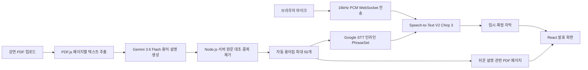

# Lecture Context AI · 강연맥락 AI

강연 PDF에서 전문용어를 자동으로 추출해 실시간 음성인식 정확도를 높이고, 자막에 어려운 용어가 등장하면 쉬운 설명과 관련 PDF 페이지를 함께 보여주는 해커톤 MVP입니다.

Google API 자격증명이 없어도 내장된 샘플 강연으로 전체 발표 흐름을 시연할 수 있습니다.

## 해결하려는 문제

일반적인 실시간 자막은 강연자의 말을 글자로 바꾸지만, 청중이 모르는 전문용어의 의미까지 설명하지는 않습니다. Lecture Context AI는 강연 자료를 먼저 읽어 자동 용어집을 만들고, 이 용어집을 음성인식 힌트와 청중용 해설에 동시에 사용합니다.

## 주요 기능

- 텍스트 PDF의 페이지별 내용 추출
- Gemini를 이용한 전문용어·영문 표기·쉬운 설명 자동 생성
- PDF 원문에 실제 존재하는 용어만 서버에서 재검증
- 최대 50개 용어로 Google STT 인라인 `PhraseSet` 생성
- 한국어 실시간 임시·확정 자막 표시
- 자막 속 전문용어 강조와 관련 PDF 페이지 연결
- 큰 글씨, 고대비, 전체 화면 등 발표 접근성 기능
- 음성 원본과 PDF를 서버에 저장하지 않는 휘발성 처리
- API 없이 실행되는 발표용 데모와 자동 종료 리포트

## 시스템 작동 구조



### 실제 사용 순서

1. 사용자가 텍스트가 포함된 PDF를 업로드합니다.
2. 브라우저가 PDF를 페이지별 텍스트로 변환합니다.
3. Gemini가 강연에 중요한 전문용어 후보와 쉬운 설명을 생성합니다.
4. 서버가 후보 용어를 PDF 원문과 다시 대조해 환각·중복·누락 표기를 제거합니다.
5. 검증된 용어와 PDF에 존재하는 영문 확장 표기를 Google STT `PhraseSet`에 전달합니다.
6. 브라우저 마이크 음성을 16kHz mono PCM으로 변환해 WebSocket으로 보냅니다.
7. Chirp 3가 실시간 자막을 반환하면 자막 속 용어를 강조합니다.
8. 용어가 처음 등장한 PDF 페이지와 쉬운 설명을 화면 옆에 표시합니다.
9. 강연 종료 이벤트를 받으면 확정 자막 수, 연결된 용어, 분석 단계에서 준비한 PhraseSet 힌트 수를 리포트로 보여줍니다.

## 기술 스택

| 영역 | 기술 | 사용 이유 |
|---|---|---|
| 프론트엔드 | React 19, TypeScript | 화면 상태와 실시간 자막 UI를 컴포넌트 단위로 관리 |
| 빌드 도구 | Vite 7 | 빠른 개발 서버와 작은 설정으로 해커톤 개발 속도 확보 |
| 스타일 | Tailwind CSS 4 | 반응형 발표 화면과 접근성 상태를 빠르게 구성 |
| 아이콘 | Lucide React | 일관된 경량 SVG 아이콘 제공 |
| PDF | PDF.js | 별도 Python/OCR 서버 없이 브라우저에서 텍스트 추출 |
| 백엔드 | Node.js 22, Express 5 | 프론트와 같은 TypeScript 생태계에서 API와 정적 파일 제공 |
| 실시간 통신 | WebSocket (`ws`) | 브라우저 오디오와 자막 이벤트를 양방향 스트리밍 |
| 요청 검증 | Zod | PDF 분석 요청과 WebSocket 용어 데이터 검증 |
| 생성형 AI | Gemini Developer API, `gemini-3.6-flash` | PDF 기반 전문용어와 비전공자용 설명 생성 |
| 음성인식 | Google Cloud Speech-to-Text V2, `chirp_3` | 한국어 스트리밍 자막과 PhraseSet 기반 음성 적응 |
| 테스트 | Vitest, TypeScript | 용어 검증 로직과 타입 안정성 확인 |
| 배포 | Docker, Google Cloud Run | 프론트와 백엔드를 단일 컨테이너로 배포 |

## 외부 API

### Gemini Developer API

- 호출 시점: PDF 업로드 후 한 번
- 입력: 페이지 번호가 포함된 PDF 추출 텍스트
- 출력: `term`, `english`, `easyExplanation` 구조의 JSON
- 안전장치: 서버가 PDF 원문에 실제 존재하는 표기만 최종 채택
- 장애 대응: API 키가 없거나 호출에 실패하면 보수적 휴리스틱 추출로 자동 전환

### Google Cloud Speech-to-Text V2

- 호출 시점: 사용자가 실시간 강연을 시작했을 때
- 모델: `chirp_3`, 언어: `ko-KR`
- 오디오: LINEAR16, 16kHz, mono
- 적응: 자동 용어집을 인라인 `PhraseSet`으로 전달
- 결과: 임시 자막과 확정 자막을 WebSocket으로 브라우저에 전달

API 키와 Google 인증정보는 브라우저에 전달하지 않고 서버 환경변수와 Cloud Run 서비스 계정에서만 사용합니다.

## 내부 API와 WebSocket

| 방식 | 경로 | 역할 |
|---|---|---|
| `GET` | `/api/health` | Gemini·Google STT 설정 여부 확인 |
| `GET` | `/api/demo` | 자격증명 없이 사용할 샘플 PDF·용어집 반환 |
| `POST` | `/api/analyze` | PDF 페이지 텍스트를 받아 자동 용어집 생성 |
| WebSocket | `/ws` | 마이크 오디오 업로드와 자막 이벤트 스트리밍 |

WebSocket은 `start` 메시지로 `live` 또는 `demo` 모드를 시작합니다. 이 메시지에는 자동 용어집과 검증된 전체 `phraseSet`이 함께 포함되며, 실시간 모드에서는 이후 오디오 바이너리를 전송합니다. 서버는 `ready`, `interim`, `final`, `error`, `ended` 이벤트를 반환하고, 화면은 `ended`를 받으면 자막을 보존한 채 결과 리포트로 이동합니다.

## 폴더 구조

```text
client/
  src/App.tsx                 전체 화면과 사용자 흐름
  src/hooks/useLectureStream.ts  WebSocket·자막 상태 관리
  src/lib/pdf.ts              PDF.js 텍스트 추출
  src/lib/pcm-recorder.ts     마이크 PCM 변환
server/
  src/index.ts                HTTP API·WebSocket 서버
  src/services/glossary.ts    Gemini·원문 검증·PhraseSet 생성
  src/services/speech.ts      Google STT V2 스트리밍
  src/services/demo.ts        발표용 샘플 데이터
docs/HANDOFF.md               인수인계 상태와 다음 작업
Dockerfile                    Cloud Run용 다단계 이미지
```

## 로컬 실행

필요 환경은 Node.js 22 이상과 pnpm 11입니다.

```bash
pnpm install
cp .env.example .env
pnpm dev
```

- 웹 화면: `http://localhost:5173`
- 백엔드 API: `http://localhost:8787`

환경변수 없이도 첫 화면에서 `샘플 강연 바로 체험하기`를 선택해 데모를 실행할 수 있습니다.

## 환경변수

```bash
PORT=8080
GOOGLE_CLOUD_PROJECT=your-google-cloud-project
GOOGLE_STT_LOCATION=us
GOOGLE_STT_MODEL=chirp_3
GEMINI_API_KEY=
GEMINI_MODEL=gemini-3.6-flash
```

### Gemini 연결

Google AI Studio에서 API 키를 발급해 `.env`의 `GEMINI_API_KEY`에 설정합니다.

### Google STT 연결

Google Cloud 프로젝트에서 Speech-to-Text V2 API를 활성화하고 로컬 Application Default Credentials를 준비합니다.

```bash
gcloud auth application-default login
```

Cloud Run에서는 로컬 인증 파일 대신 서비스 계정에 Speech-to-Text 호출 권한을 부여합니다.

## 검증 명령

```bash
pnpm typecheck
pnpm test
pnpm build
pnpm start
docker build -t lecture-context-ai:mvp .
```

## Cloud Run 배포

프론트엔드와 백엔드는 하나의 컨테이너로 실행됩니다. Gemini 키는 소스에 기록하지 않고 Secret Manager 또는 Cloud Run secret 환경변수로 연결합니다.

```bash
gcloud run deploy lecture-context-ai \
  --source . \
  --region asia-northeast3 \
  --allow-unauthenticated \
  --min 0 \
  --max 1 \
  --memory 512Mi \
  --cpu 1 \
  --timeout 3600 \
  --set-env-vars GOOGLE_CLOUD_PROJECT=YOUR_PROJECT_ID,GOOGLE_STT_LOCATION=us,GOOGLE_STT_MODEL=chirp_3 \
  --set-secrets GEMINI_API_KEY=gemini-api-key:latest
```

## 개인정보와 비용 원칙

- 음성 원본과 PDF 파일을 서버에 영구 저장하지 않습니다.
- Gemini는 PDF 업로드 시 한 번만 호출해 실시간 지연과 토큰 비용을 줄입니다.
- STT는 전송한 오디오 길이를 기준으로 과금될 수 있습니다.
- 공개 배포 전 Google Cloud 예산 알림과 API 할당량을 설정해야 합니다.

## 현재 MVP 제한

- 텍스트가 포함된 10MB·100페이지 이하 PDF만 지원합니다.
- 스캔 PDF OCR, 화자 분리, 번역, TTS는 포함하지 않습니다.
- 데이터베이스, 회원가입, 강연자 검수 화면은 포함하지 않습니다.
- 실제 Gemini와 Google STT 경로는 프로젝트 자격증명 연결 후 추가 검증이 필요합니다.
- 긴 강연을 위한 STT 스트림 자동 재연결은 아직 구현하지 않았습니다.
- 실제 발화 시작 시점을 신뢰성 있게 추적하지 않으므로 결과 화면에서 실시간 표시 지연을 추정해 보여주지 않습니다.
- 쉬운 용어 정의는 제공하지만 `이 용어가 지금 등장한 이유`를 설명하는 맥락 문장은 다음 버전 작업입니다.

현재 상태와 후속 작업은 [인수인계 문서](docs/HANDOFF.md)를 참고하세요. 논문 연구문제, 평가 설계, 발표 흐름은 [논문·발표 구성안](docs/PAPER_PRESENTATION_PLAN.md)에 정리되어 있습니다.
