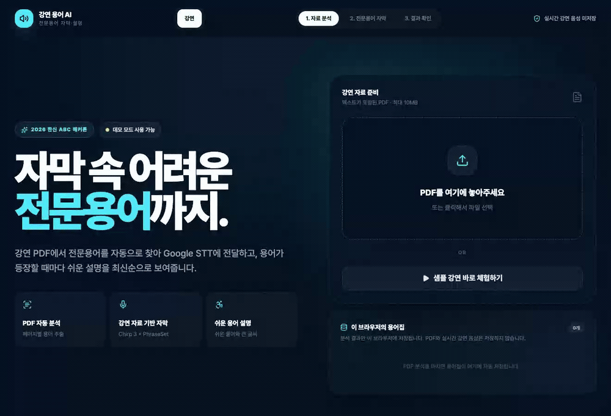
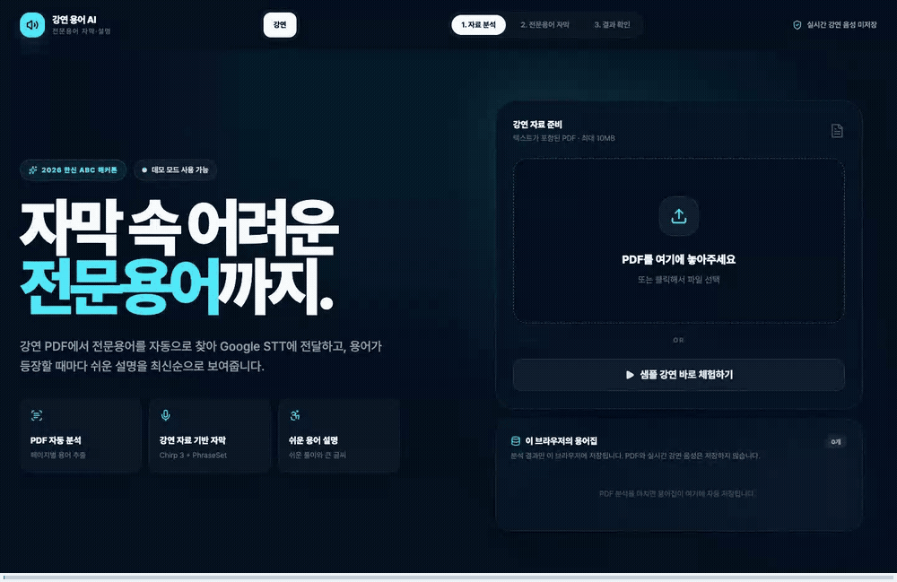
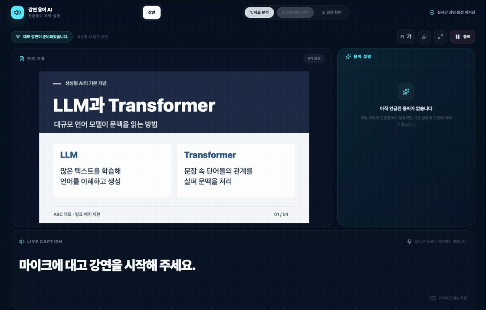
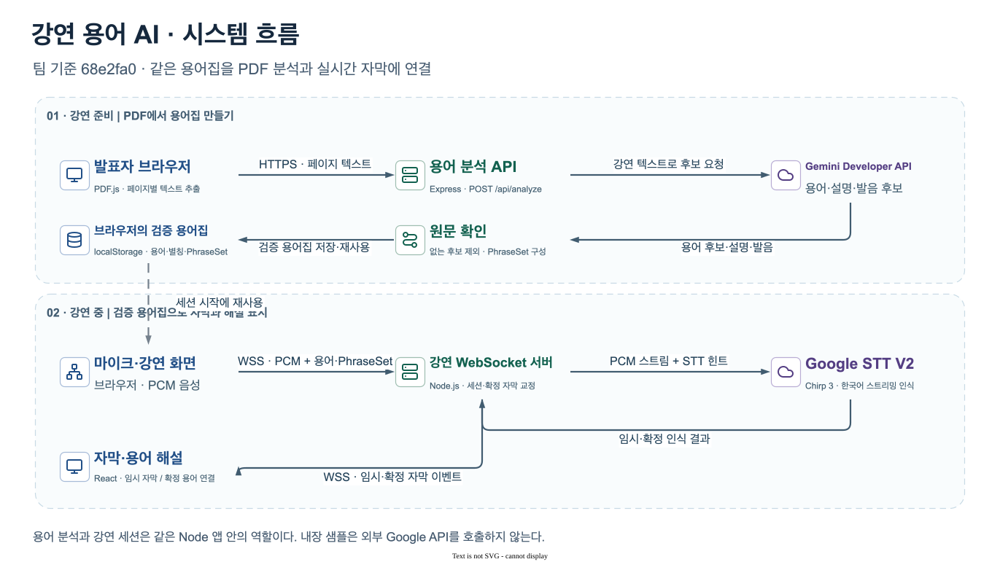
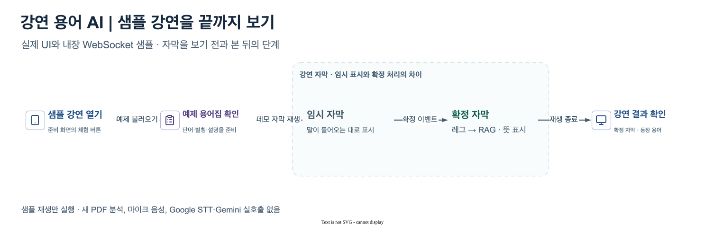
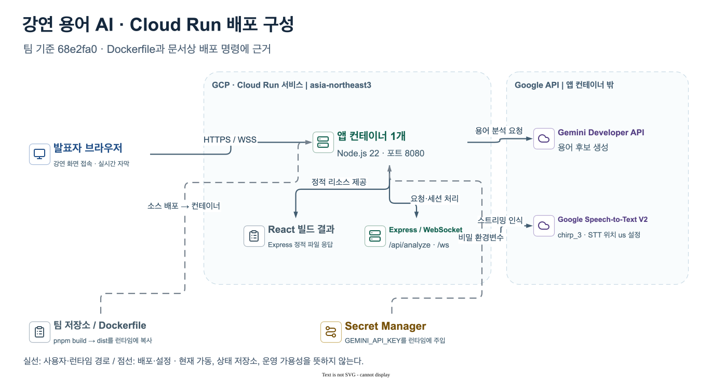

# 강연 용어 AI

발표 자료의 전문용어를 미리 골라 음성인식 힌트와 청중용 해설에 함께 쓰는 **해커톤 팀 프로젝트**다. 자막에 용어가 등장하면 청중은 강연을 멈추지 않고 설명을 확인할 수 있다.

**담당 범위:** 자막 표시 방식 설계, Google STT V2와 실시간 스트림 안정화, 브라우저 용어집 재사용, 확정 자막 별칭 교정, STT 비교 실험 UI.

[팀 최종 병합본](https://github.com/nsjjjjjj/lecture-context-ai/pull/3) · [기술 문서 `68e2fa0`](https://github.com/nsjjjjjj/lecture-context-ai/blob/68e2fa0ef2926b783b5e1f941ca9bdc90ab2630e/README.md) · [로컬 데모 재현](docs/demo-reproduction.md)

## 주요 사용 흐름

### 발표자: PDF에서 용어집을 만들고 다시 불러오기

발표 PDF를 올리면 해당 자료에 나오는 용어와 STT에 넘길 표기를 확인할 수 있다. 시연에서는 생성형 AI 한 장짜리 자료에서 **RAG, LLM, Transformer**를 뽑는다. 준비된 용어집은 브라우저에 저장되므로 다음에 같은 강연을 열 때 PDF 대신 용어집을 고른다.

[PDF 분석을 마친 준비 화면](docs/media/presenter-prepare.png) · [용어집을 다시 연 화면](docs/media/presenter-reopened.png)

### 청중: 자막에서 용어를 찾고 강연 뒤 결과 다시 읽기

샘플 자막에서 ‘레그’가 확정되면 **RAG(레그)**로 표시되고 오른쪽에 뜻이 열린다. 재생이 끝나면 확정 자막과 등장 용어를 다시 볼 수 있다.

[시작 화면](docs/media/abc-start.png) · [용어집 화면](docs/media/abc-glossary.png) · [자막과 설명](docs/media/lecture-demo.png) · [결과 화면](docs/media/abc-demo-results.png)

발표 당시 배치 재현: 별도 PPT와 자막을 함께 보기

발표 때처럼 자막 기록 영역에 별도 PPT를 겹쳐 띄웠다. LLM·Transformer, RAG, 환각, 파인튜닝에 해당하는 슬라이드와 하단 자막, 오른쪽 용어 설명을 나란히 볼 수 있다. PPT는 앱의 내장 기능이 아니다.

[발표 배치 정지 화면](docs/media/lecture-presentation.png) · [슬라이드 제작·합성 기록](docs/slides/REPRODUCE-PRESENTATION.md)

### 실험 담당자: 같은 음원으로 인식 조건 비교

저장된 비교 결과에서 다섯 케이스의 CSV를 내려받고 보고서 하나의 인식 지표를 연다. 보고서에서는 음성인식이 바로 알아들은 용어와 앱이 발음 별칭으로 연결한 용어를 나눠 확인할 수 있다.

[케이스 집계 화면](docs/media/experiment-aggregates.png) · [보고서 상세](docs/media/experiment-report.png) · [팀 실험에서 확인한 수치](#용어-인식-실험) · [실험 화면과 채점 기준 설명](docs/STT_PHRASESET_PILOT.md)

## 해결한 문제

자막이 있어도 전문용어를 처음 듣는 청중에게는 맥락이 부족하다. 별도로 용어를 검색하는 동안 강연은 계속되고, 낯선 발음이나 약어는 음성인식에서 다른 단어로 바뀔 수도 있다. 자료에서 근거를 찾은 **용어집 하나**를 인식 힌트와 쉬운 설명에 모두 쓰도록 설계했다.

## 설계 결정

### 강연 자료를 먼저 읽고, 용어집 하나를 인식과 해설에 함께 사용

범용 STT는 발표자가 어떤 자료를 설명하고 있는지 모른다. 반대로 Gemini가 제안한 용어를 그대로 사용하면 자료에 없는 단어도 인식 후보가 된다. 그래서 브라우저에서 PDF.js로 텍스트를 페이지별로 뽑고, 서버는 Gemini가 제안한 표기를 추출 텍스트에서 다시 검색한다. 문서 안에서 찾은 후보만 남겨 첫 등장 페이지와 출현 횟수를 기록한다. 모델을 쓸 수 없을 때도 약어와 미리 정의한 전문용어를 찾는 규칙 기반 경로를 둔다.

확정한 용어집에서 Google STT에 건넬 PhraseSet과 청중에게 보여줄 설명 카드를 함께 만든다. 인식 쪽과 화면 쪽에 서로 다른 용어 목록을 두지 않아, 자막에 연결된 용어가 어느 쪽에서도 같은 항목을 가리킨다. 이 방식에서 원문 검사는 용어가 자료에서 실제로 쓰였는지를 확인하고, 설명문은 비전공자가 읽기 쉬운 길이와 형식으로 다듬는 역할을 각각 맡는다.

### 임시 자막은 먼저 보여주고, 발음 교정과 용어 설명은 확정 뒤에

음성인식이 문장 앞부분을 먼저 내보내면 임시 결과의 단어는 문장이 끝날 때 바뀔 수 있다. 모든 결과를 기다리면 청중이 강연을 따라가기 어렵고, 반대로 임시 결과가 들어올 때마다 용어 카드를 추가하면 잠깐 나타났다가 사라진 단어도 이력에 남는다. 현재 자막과 확정 기록을 분리해 임시 자막은 바로 갱신하고, 확정 이벤트에서만 용어 강조와 설명 카드 생성을 처리했다.

한국어로 읽은 영문 약어는 인식기가 실제로 반환한 발음을 무조건 덮어쓰지 않는다. 검토 규칙을 통과한 별칭만 같은 용어의 ID에 연결하고, 화면은 `RAG(레그)`처럼 정식 표기와 인식 원문을 함께 보여준다. 설명 카드는 늦게 열리는 대신 자막에 실제로 확정된 말에만 반응하며, 청중은 전문용어의 표기와 발음을 함께 확인할 수 있다.

### 종료 버튼은 오디오 전송을 멈추고 마지막 확정 자막까지 받는다

브라우저는 마이크 입력을 16kHz 모노 PCM으로 변환해 WebSocket으로 보내고, 서버는 첫 메시지로 용어 힌트와 인식 설정을 넘긴 뒤 오디오를 Google STT에 전달한다. 사용자가 종료할 때 브라우저와 STT 스트림을 곧바로 같이 끊으면 아직 도착하지 않은 마지막 확정 자막이 빠질 수 있다.

서버는 종료 요청을 받으면 더는 오디오를 쓰지 않고 입력 스트림만 먼저 닫는다. 이후에도 인식 결과를 받아 자막으로 보내며, STT가 연결을 끝내거나 최대 5초의 대기 시간이 지나면 종료를 한 번만 알린다. 마지막 문장을 받을 시간을 주되, 응답이 없는 연결 때문에 결과 화면 전환이 끝없이 늦어지지 않도록 한 선택이다.

### PDF나 음성이 아니라 다시 쓸 용어집만 저장

리허설 때 분석한 자료를 발표 직전에 다시 올리면 같은 PDF를 읽고 모델을 호출하는 일을 반복한다. 반면 파일이나 원문 전체를 저장하면 용어집을 다시 고르는 데 필요하지 않은 자료까지 남게 된다. 브라우저에 용어·발음 별칭·쉬운 설명과 PhraseSet을 저장하고, 같은 브라우저에서 저장된 용어집을 선택하면 PDF 분석을 건너뛰고 바로 준비 화면으로 돌아가게 했다.

발표 파일과 마이크 입력은 이 저장 대상에 포함하지 않는다. 준비 시간을 줄이는 범위를 같은 브라우저의 재사용으로 잡은 덕분에 용어집을 위한 계정 서버나 PDF 저장소를 두지 않았다. 용어집은 시작 화면에서 이름을 바꾸거나 삭제할 수 있다.

[상세 설계 기록](docs/design-decisions.md) · [실험 설계와 결과](docs/STT_PHRASESET_PILOT.md)

## 시스템 구조와 데이터 흐름

1. **강연 준비:** 브라우저에서 PDF.js로 페이지 텍스트를 읽고 서버에 보낸다. 서버가 Gemini 후보를 원문과 대조하고, 용어집과 인식 힌트를 돌려준다.
2. **강연 중:** 브라우저가 음성과 용어 힌트를 WebSocket으로 보낸다. Express 앱이 Google STT V2와 연결하고 임시·확정 자막을 브라우저에 전달한다.
3. **청중 확인:** 확정 자막과 연결된 용어 설명을 바로 보여주고, 강연이 끝나면 등장 용어를 결과 화면에서 확인한다.

[편집 가능한 시스템 draw.io 원본](docs/architecture/abc-system.drawio)

### 샘플 강연 워크플로

임시 자막에서는 지금 들어오는 문장을 보고, 확정 자막에서는 교정된 용어와 설명을 확인한다. 끝나면 자막과 등장 용어를 한 화면에서 돌아볼 수 있다.

[워크플로 draw.io 원본](docs/architecture/abc-workflow.drawio)

## 배포 구성

**Cloud Run 컨테이너 하나**가 React 정적 파일과 Express API·WebSocket을 함께 제공한다. PDF 용어 분석과 음성인식은 각각 Gemini와 Google STT V2로 요청한다.

[편집 가능한 인프라 draw.io 원본](docs/architecture/abc-infrastructure.drawio)

## 용어 인식 실험

기술 강연 5개를 조건별로 3회씩 재생했다. 목표 용어 출현 213회를 기준으로, 힌트가 없을 때 60회, 정식 용어를 힌트로 줄 때 117회, 발음 별칭을 힌트에 넣고 확정 자막에서 정식 용어로 연결할 때 180회가 인식 또는 연결됐다. 마지막 조건의 180회 중 76회는 정식 표기를 바로 인식했고, 104회는 발음 별칭을 정식 용어에 연결했다. 자막에 적힌 발음으로도 같은 용어 설명을 띄울 수 있도록 한 이유다.

[실험 방법과 원자료](docs/STT_PHRASESET_PILOT.md) · [샘플 강연 실행](docs/demo-reproduction.md)
